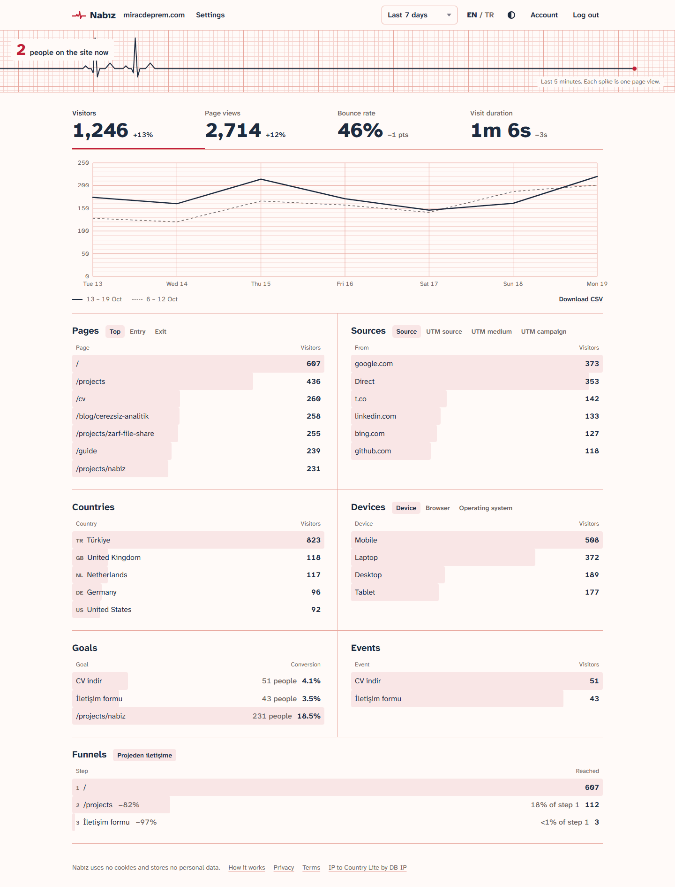
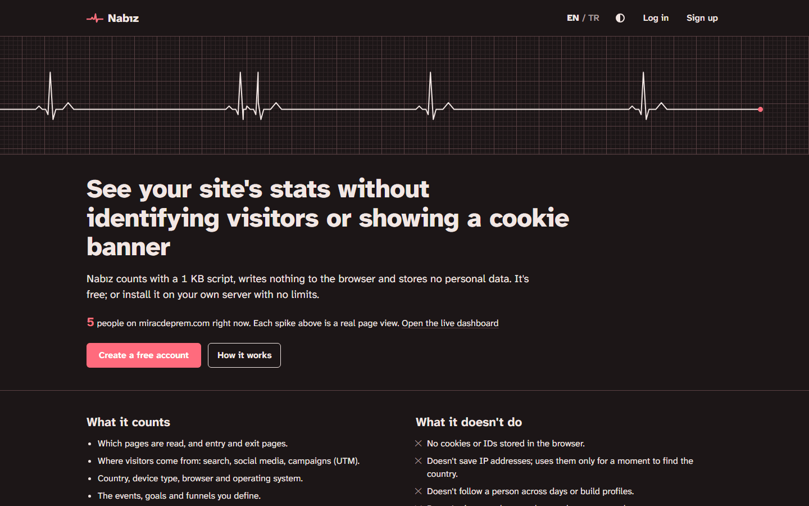
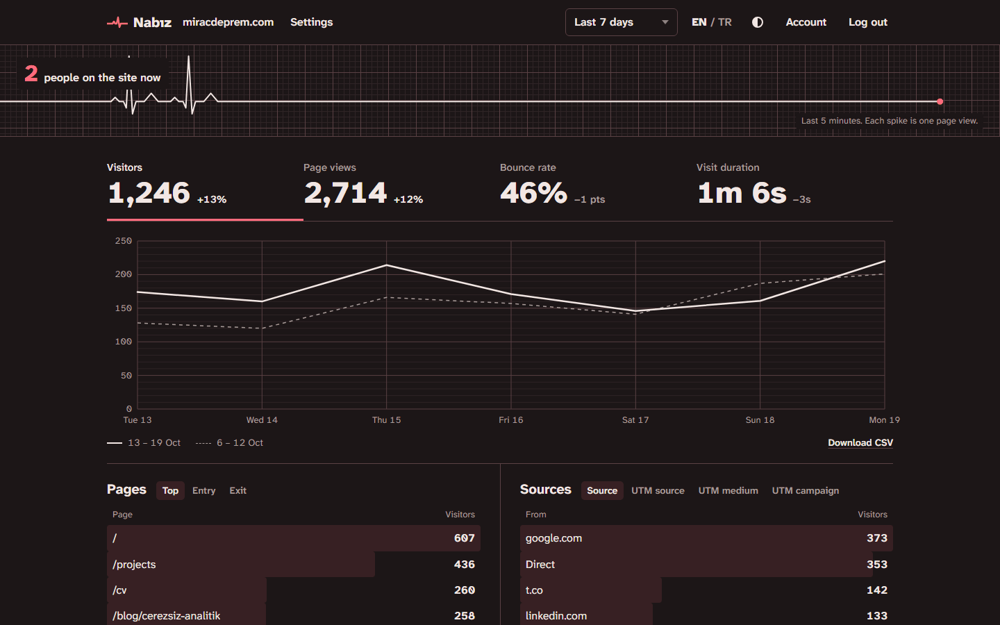
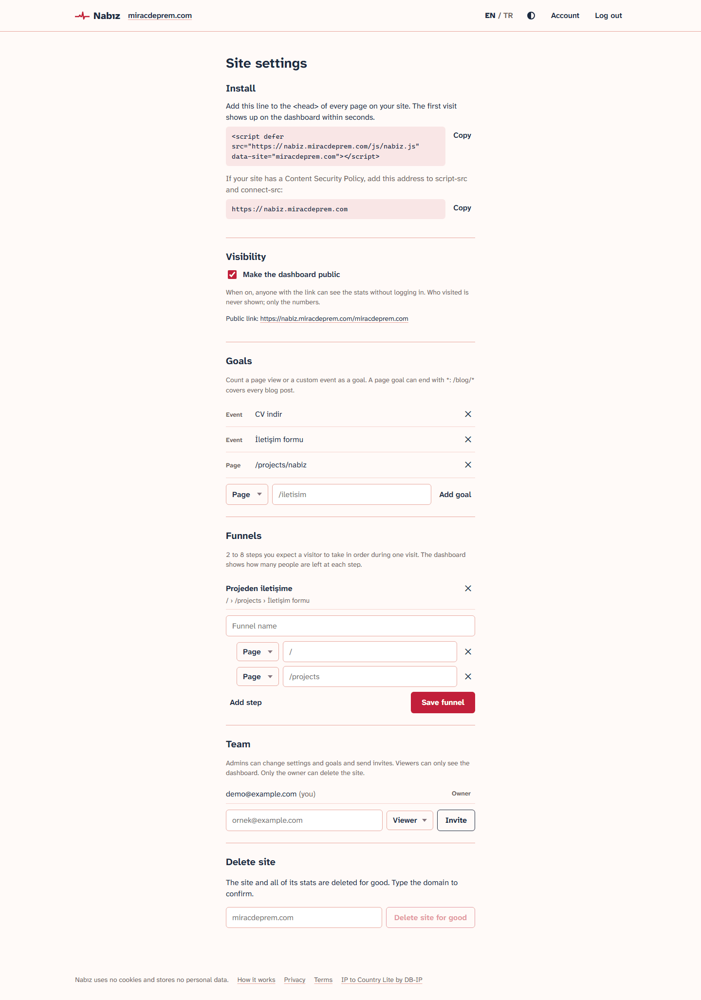

English | [Türkçe](README.tr.md)

# Nabız

Cookie-free, privacy-friendly web analytics: a Google Analytics alternative that needs no cookie banner, stores no personal data and runs as a single Go binary with SQLite. Use it free at [nabiz.miracdeprem.com](https://nabiz.miracdeprem.com) or install it on your own server with no limits.

**Live:** [nabiz.miracdeprem.com](https://nabiz.miracdeprem.com) · **Public demo dashboard:** [nabiz.miracdeprem.com/miracdeprem.com](https://nabiz.miracdeprem.com/miracdeprem.com)



## Features

**Tracking**
- Dependency-free tracking script under 1 KB (gzip): page views, single-page app route changes, custom events with properties.
- One line to install: a `<script>` tag with the site's domain.
- Sends only the page path and campaign parameters (`utm_*`, `ref`, `source`). The `#` part and other query values (tokens, keys) never leave the browser.
- `data-mask="/bookings/:id"`: addresses that carry an ID or a code are sent as the pattern, so the ID stays in the browser.
- Respects Do Not Track; skips bots, headless browsers, localhost and the site owner's own visits.
- Proxy guide for Vercel, Caddy and Nginx, so the script loads from your own domain.

**Privacy**
- No cookies, nothing written to the browser, no fingerprint kept.
- Visitors are counted with `hash(daily salt + site + IP + user agent)`. The salt rotates every day and the old one is deleted, so visits can't be linked across days.
- The IP is used only in memory to find the country and is never written to disk.
- "How it works", privacy (KVKK / GDPR) and terms pages, plus a ready-made paragraph for your site's privacy notice.

**Dashboard**
- Live pulse strip: people on the site now; each spike is a page view from the last 5 minutes.
- Visitors, page views, bounce rate and visit duration, compared with the previous period.
- Time series chart for today, 7 days, 30 days, this month, 12 months or a custom range.
- Top, entry and exit pages; sources and UTM campaigns; countries, devices, browsers and operating systems.
- Click any row to filter the whole dashboard.
- Goals with conversion rate (page or custom event), event property breakdowns, funnels.
- CSV export.
- Turkish and English, light and dark theme.

**Accounts and teams**
- Sign up with email verification, password reset, email change, account deletion with all data.
- Multiple sites per account; optional public dashboard per site.
- Team invitations by email with owner, admin and viewer roles.

**Hosting**
- The public instance is free for everyone, with a monthly usage meter and fair limits (10,000 page views, 2 sites).
- Self-hosted mode has no plans or limits.
- Optional paid plans through iyzico subscriptions for operators with a merchant account: card data never reaches the server, webhooks are signed. Off unless the iyzico keys are set.

**Server**
- Origin check against registered sites, bot filtering and rate limiting.
- Local IP-to-country database (DB-IP Lite), no third-party lookup; refreshed monthly.
- SQLite in WAL mode with covering indexes: dashboard queries stay under half a second at 1 million events.
- Nightly backup, systemd unit with sandboxing, Caddy example.

## Screenshots

| Landing page | Dark theme |
|---|---|
|  |  |



## Tech Stack

- **Server:** Go (standard library HTTP server), SQLite (`modernc.org/sqlite`, no CGO)
- **Dashboard:** TypeScript, Vite, no UI framework
- **Tracker:** plain JavaScript, built with esbuild
- **Security:** Argon2id, strict CSP with Trusted Types, Go's cross-origin protection against CSRF
- **Payments:** iyzico subscriptions (optional)
- **Hosting:** Caddy, systemd, Oracle Cloud

## Installation

**Hosted:** create a free account at [nabiz.miracdeprem.com](https://nabiz.miracdeprem.com), add your site and paste the line it gives you into your pages:

```html
<script defer src="https://nabiz.miracdeprem.com/js/nabiz.js" data-site="example.com"></script>
```

**Self-hosted:** one binary, SQLite, systemd and Caddy; no limits. See [docs/self-hosting.md](docs/self-hosting.md).

**Serving the script from your own domain** (keeps working with ad blockers): [docs/proxy.md](docs/proxy.md).

**Building from source:**

```sh
cd web && npm ci && npm run build && cd ..
CGO_ENABLED=0 go build -trimpath -ldflags "-s -w" -o nabiz ./cmd/nabiz
./nabiz user add -data ./data you@example.com
./nabiz serve -data ./data -addr 127.0.0.1:8080
```

Tests: `go test ./...` and `cd web && npm test`.

## What I Learned

- **Counting people without identifying them.** I hash the IP and user agent together with a salt that changes every day and is then deleted. The same person counts once per day, but even I can't link Monday's visit to Tuesday's. That one decision is why no cookie banner is needed.
- **Making SQLite fast enough.** My first dashboard queries took 2 to 4 seconds at 1 million events. I wrote a benchmark, added covering indexes, replaced `COUNT(DISTINCT)` with my own aggregate function in Go and rewrote filters as `IN` subqueries. Every query now runs under 400 ms. I also learned to keep one connection for writes and a separate read-only pool, because SQLite allows a single writer.
- **Writing a tracker that stays under 1 KB.** `sendBeacon` with a `text/plain` body avoids the CORS preflight and still sends when the page is closing. Single-page apps don't reload, so I wrap `history.pushState` to count route changes.
- **Privacy bugs hide in small details.** The tracker first sent `location.href`. On my file-sharing project Zarf, that would have leaked the decryption key in the `#` part of the address to the analytics server. Now it sends only the path and campaign parameters, and `data-mask` hides IDs in paths. I found the second case while adding Nabız to my own sites: a public dashboard would have shown booking IDs and joinable game room codes.
- **Trusting the right IP address.** Behind a proxy, the first `X-Forwarded-For` entry is the visitor (used for counting and country) but can be faked, while the last entry is added by my own proxy (used for rate limiting). Mixing them up either breaks counting or lets anyone bypass the limits.
- **Web security without a framework.** Session cookies use the `__Host-` prefix, HttpOnly, Secure and SameSite=Strict. CSRF protection comes from Go's built-in cross-origin check. The dashboard never uses `innerHTML`, and the CSP enforces that with Trusted Types. Password hashing with Argon2id uses 64 MB of memory, so I limit how many hashes run at once.
- **Payments with signatures.** iyzico requests are signed with HMAC, and webhooks are checked against their signature and recorded so the same event isn't applied twice. The payment form runs on its own page with a nonce-based CSP.
- **Small things that break email.** A sender name with a Turkish letter ("Nabız") has to be encoded according to RFC 2047, or some email apps show garbled text.
- **Running it on a real server.** Hardened systemd unit, a dedicated user, a settings file only root can read, nightly `VACUUM INTO` backups, a monthly timer that downloads the new country database, and a `SIGHUP` handler that loads it without restarting the server.

## License

[AGPL-3.0](LICENSE). If your company can't meet the AGPL terms (for example, you want to change the code without publishing the changes), a commercial license is possible: [get in touch](https://www.miracdeprem.com/#contact).
