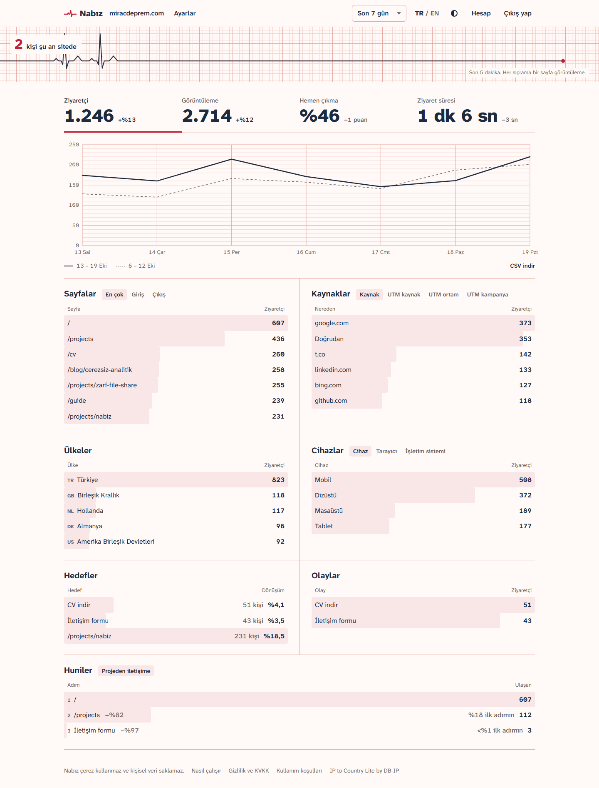
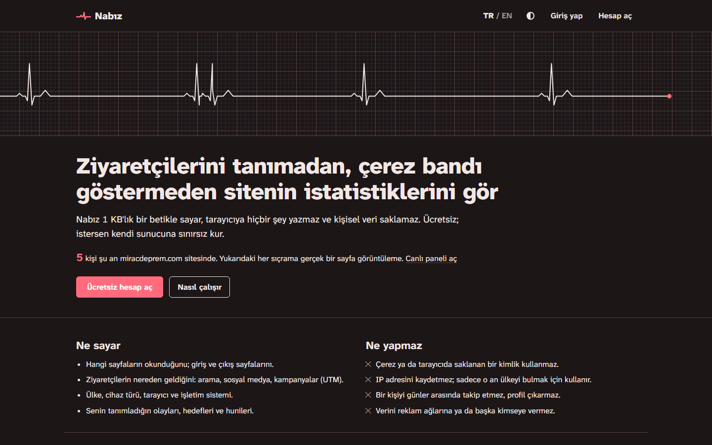
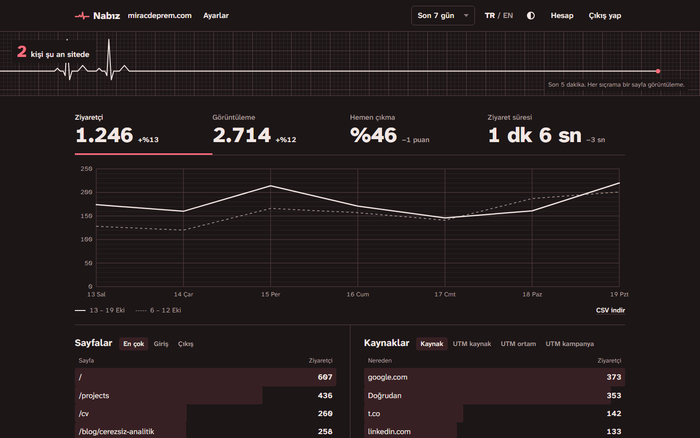
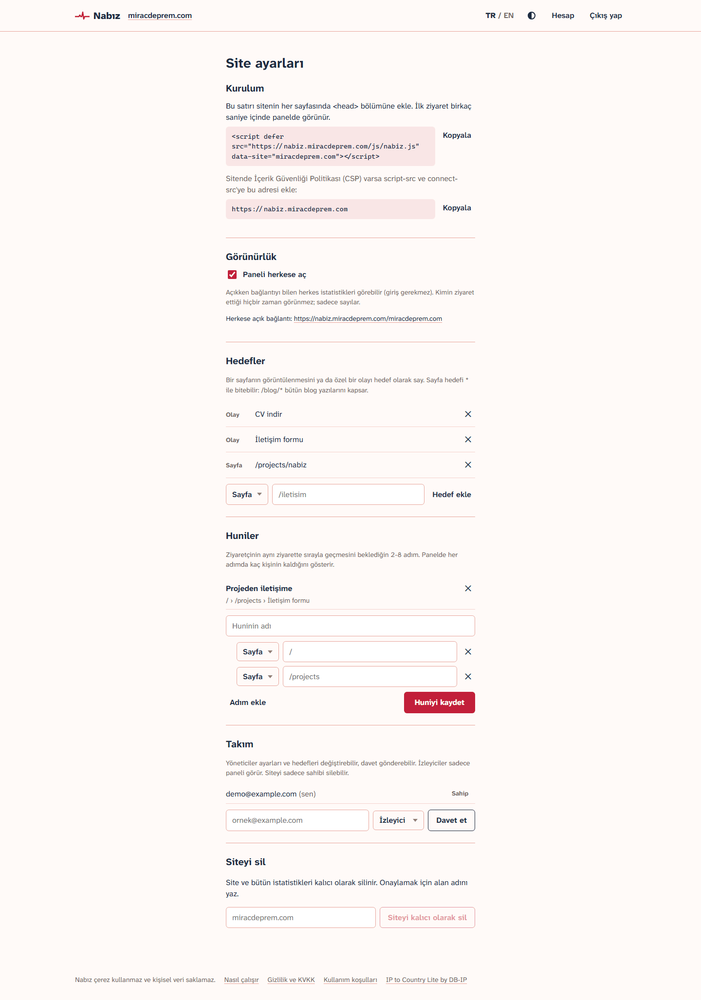

[English](README.md) | Türkçe

# Nabız

Çerezsiz ve gizlilik dostu web analitiği: çerez onay bandı gerektirmeyen, kişisel veri saklamayan, tek Go dosyası ve SQLite ile çalışan bir Google Analytics alternatifi. [nabiz.miracdeprem.com](https://nabiz.miracdeprem.com) adresinde ücretsiz kullanabilir ya da kendi sunucuna sınırsız kurabilirsin.

**Canlı:** [nabiz.miracdeprem.com](https://nabiz.miracdeprem.com) · **Herkese açık örnek panel:** [nabiz.miracdeprem.com/miracdeprem.com](https://nabiz.miracdeprem.com/miracdeprem.com)



## Özellikler

**Takip**
- 1 KB altında (gzip), bağımlılıksız takip betiği: sayfa görüntüleme, tek sayfalık uygulamalarda adres değişimi, özellikli özel olaylar.
- Tek satırla kurulur: sitenin alan adını taşıyan bir `<script>` etiketi.
- Sadece sayfa yolunu ve kampanya parametrelerini (`utm_*`, `ref`, `source`) gönderir. Adresin `#` kısmı ve diğer sorgu değerleri (token, anahtar) tarayıcıdan çıkmaz.
- `data-mask="/bookings/:id"`: kimlik ya da kod taşıyan adresler kalıp olarak gönderilir, kimlik tarayıcıda kalır.
- Do Not Track ayarına uyar; botları, başsız tarayıcıları, localhost'u ve site sahibinin kendi ziyaretlerini saymaz.
- Betiğin kendi alan adından yüklenmesi için Vercel, Caddy ve Nginx proxy rehberi.

**Gizlilik**
- Çerez yok, tarayıcıya hiçbir şey yazılmaz, parmak izi saklanmaz.
- Ziyaretçiler `hash(günlük tuz + site + IP + tarayıcı)` ile sayılır. Tuz her gün yenilenir ve eskisi silinir, böylece ziyaretler günler arasında birbirine bağlanamaz.
- IP sadece bellekte ülkeyi bulmak için kullanılır ve diske hiç yazılmaz.
- "Nasıl çalışır", gizlilik (KVKK / GDPR) ve kullanım koşulları sayfaları; ayrıca sitenin gizlilik metnine eklenecek hazır bir paragraf.

**Panel**
- Canlı nabız şeridi: şu an sitede kaç kişi olduğu; her sıçrama son 5 dakikadaki bir sayfa görüntüleme.
- Ziyaretçi, görüntüleme, hemen çıkma oranı ve ziyaret süresi; önceki dönemle karşılaştırmalı.
- Bugün, 7 gün, 30 gün, bu ay, 12 ay ya da özel aralık için zaman grafiği.
- En çok görüntülenen, giriş ve çıkış sayfaları; kaynaklar ve UTM kampanyaları; ülkeler, cihazlar, tarayıcılar ve işletim sistemleri.
- Herhangi bir satıra tıklayınca bütün panel o değere göre süzülür.
- Dönüşüm oranlı hedefler (sayfa ya da özel olay), olay özelliği kırılımları, huniler.
- CSV dışa aktarma.
- Türkçe ve İngilizce, açık ve koyu tema.

**Hesaplar ve takımlar**
- E-posta doğrulamalı kayıt, şifre sıfırlama, e-posta değiştirme, bütün verisiyle hesap silme.
- Hesap başına birden çok site; her site için isteğe bağlı herkese açık panel.
- Sahip, yönetici ve izleyici rolleriyle e-posta üzerinden takım daveti.

**Barındırma**
- Herkese açık sunucu herkes için ücretsiz; aylık kullanım sayacı ve makul sınırlar (10.000 görüntüleme, 2 site).
- Kendi sunucuna kurulumda paket ya da sınır yok.
- Üye iş yeri hesabı olan işletmeciler için iyzico aboneliğiyle isteğe bağlı ücretli paketler: kart bilgisi sunucuya hiç ulaşmaz, webhook'lar imzalıdır. iyzico anahtarları girilmedikçe kapalıdır.

**Sunucu**
- Kayıtlı sitelere göre Origin kontrolü, bot filtresi ve istek sınırlama.
- Yerel IP-ülke veritabanı (DB-IP Lite), üçüncü taraf sorgusu yok; her ay yenilenir.
- WAL modunda SQLite ve kapsayıcı indeksler: 1 milyon olayda panel sorguları yarım saniyenin altında.
- Gece yedeği, korumalı systemd birimi, Caddy örneği.

## Ekran Görüntüleri

| Tanıtım sayfası | Koyu tema |
|---|---|
|  |  |



## Kullanılan Teknolojiler

- **Sunucu:** Go (standart kütüphanenin HTTP sunucusu), SQLite (`modernc.org/sqlite`, CGO yok)
- **Panel:** TypeScript, Vite, arayüz çatısı yok
- **Takip betiği:** sade JavaScript, esbuild ile derlenir
- **Güvenlik:** Argon2id, Trusted Types'lı sıkı CSP, CSRF'e karşı Go'nun kaynaklar arası istek koruması
- **Ödeme:** iyzico abonelikleri (isteğe bağlı)
- **Barındırma:** Caddy, systemd, Oracle Cloud

## Kurulum ve Çalıştırma

**Hazır sunucu:** [nabiz.miracdeprem.com](https://nabiz.miracdeprem.com) adresinde ücretsiz hesap aç, siteni ekle ve verdiği satırı sayfalarına koy:

```html
<script defer src="https://nabiz.miracdeprem.com/js/nabiz.js" data-site="example.com"></script>
```

**Kendi sunucunda:** tek program dosyası, SQLite, systemd ve Caddy; sınır yok. Bkz. [docs/self-hosting.tr.md](docs/self-hosting.tr.md).

**Betiği kendi alan adından sunmak** (reklam engelleyicilere takılmaz): [docs/proxy.tr.md](docs/proxy.tr.md).

**Kaynaktan derleme:**

```sh
cd web && npm ci && npm run build && cd ..
CGO_ENABLED=0 go build -trimpath -ldflags "-s -w" -o nabiz ./cmd/nabiz
./nabiz user add -data ./data sen@example.com
./nabiz serve -data ./data -addr 127.0.0.1:8080
```

Testler: `go test ./...` ve `cd web && npm test`.

## Öğrendiklerim

- **İnsanları tanımadan saymak.** IP'yi ve tarayıcı bilgisini her gün değişen, sonra silinen bir tuzla birlikte özetliyorum. Aynı kişi gün içinde bir kez sayılıyor ama pazartesi ve salı ziyaretlerini ben bile birbirine bağlayamıyorum. Çerez bandına gerek kalmamasının nedeni bu tek karar.
- **SQLite'ı yeterince hızlandırmak.** İlk panel sorgularım 1 milyon olayda 2-4 saniye sürüyordu. Bir benchmark yazdım, kapsayıcı indeksler ekledim, `COUNT(DISTINCT)` yerine Go'da kendi toplama fonksiyonumu yazdım ve filtreleri `IN` alt sorgularına çevirdim. Şimdi her sorgu 400 ms'nin altında. SQLite aynı anda tek yazara izin verdiği için yazma işlerine tek bağlantı, okumaya ayrı bir salt okunur havuz ayırmayı da öğrendim.
- **1 KB altında kalan bir takip betiği yazmak.** `sendBeacon` ve `text/plain` gövde, CORS ön isteğine takılmıyor ve sayfa kapanırken bile gönderiyor. Tek sayfalık uygulamalar yeniden yüklenmediği için adres değişimlerini saymak üzere `history.pushState`'i sarıyorum.
- **Gizlilik hataları küçük ayrıntılarda saklanır.** Betik önce `location.href`'i gönderiyordu. Dosya paylaşım projem Zarf'ta bu, adresin `#` kısmındaki şifre çözme anahtarını analitik sunucusuna sızdırırdı. Artık sadece yol ve kampanya parametreleri gidiyor; yollardaki kimlikleri de `data-mask` gizliyor. İkinci durumu Nabız'ı kendi sitelerime eklerken buldum: herkese açık panel rezervasyon kimliklerini ve katılınabilir oyun odası kodlarını gösterecekti.
- **Doğru IP adresine güvenmek.** Proxy arkasında `X-Forwarded-For`'daki ilk değer ziyaretçidir (sayma ve ülke için kullanıyorum) ama sahte olabilir; son değeri ise benim proxy'im ekler (istek sınırlama için kullanıyorum). İkisini karıştırmak ya saymayı bozar ya da herkesin sınırı aşmasına izin verir.
- **Çatı kullanmadan web güvenliği.** Oturum çerezi `__Host-` önekli, HttpOnly, Secure ve SameSite=Strict. CSRF koruması Go'nun yerleşik kaynaklar arası istek kontrolünden geliyor. Panel hiç `innerHTML` kullanmıyor; CSP bunu Trusted Types ile zorunlu kılıyor. Argon2id şifre özeti 64 MB bellek kullandığı için aynı anda kaç özet hesaplanacağını sınırlıyorum.
- **İmzalarla ödeme.** iyzico istekleri HMAC ile imzalanıyor; webhook'ların imzası kontrol ediliyor ve aynı olay iki kez uygulanmasın diye kaydediliyor. Ödeme formu nonce tabanlı CSP'si olan ayrı bir sayfada çalışıyor.
- **E-postayı bozan küçük şeyler.** Gönderen adında Türkçe harf olunca ("Nabız") RFC 2047'ye göre kodlanması gerekiyor; yoksa bazı e-posta programları bozuk gösteriyor.
- **Gerçek bir sunucuda çalıştırmak.** Sıkılaştırılmış systemd birimi, ayrı bir kullanıcı, sadece root'un okuyabildiği ayar dosyası, her gece `VACUUM INTO` yedeği, yeni ülke veritabanını her ay indiren bir zamanlayıcı ve onu sunucuyu yeniden başlatmadan yükleyen bir `SIGHUP` işleyicisi.

## Lisans

[AGPL-3.0](LICENSE). Şirketin AGPL koşullarını karşılayamıyorsa (ör. kodu değiştirip değişiklikleri yayınlamak istemiyorsan) ticari lisans mümkün: [iletişime geç](https://www.miracdeprem.com/#contact).
